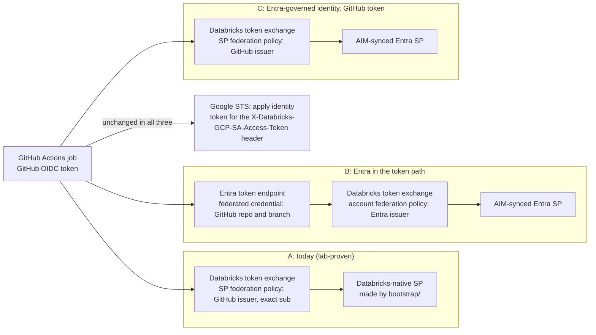

# Entra identity for GitHub Actions, provisioned by AIM: viability

**Assessment, 2026-11-13; its open points tested the same day (use case test U7).** The customer asked whether the pipeline could authenticate to Databricks as a **Microsoft Entra ID identity** that **automatic identity management (AIM)** pushes into the Databricks account, instead of a Databricks-native service principal. This is a desk assessment against the Databricks on GCP documentation; the lab didn't test it (H11 was out of scope, and AIM needs the account's SSO to be Entra, which the lab's account wasn't at the time).

## Short answer

**Viable on GCP. Option C is proven at account level; option B is untested.**

- AIM with Entra is generally available on Databricks on GCP (May 2026), syncs Entra **service principals**, and Databricks on GCP accepts Entra-issued tokens through **OAuth token federation**. So an Entra service principal can be the pipeline's Databricks identity.
- Databricks on GCP doesn't accept Entra tokens directly, as Azure Databricks does: every Entra token goes through Databricks' token exchange against a federation policy.
- **The Google side doesn't change.** Creating workspaces, network configurations and endpoint registrations still needs a Google access token in `X-Databricks-GCP-SA-Access-Token` (hypotheses H3 and H4 in [E1](deliverables/E1_RESULTS.md)), so the pipeline keeps its Google workload identity federation either way.
- Three things the documentation doesn't settle decided whether it works for this pipeline. **All three were tested and hold** (use case test U7): a synced service principal's Databricks **application ID is its Entra client ID**; it can hold **account admin**; and it can carry its **own federation policy**. With that policy, a GitHub Actions job signed in as the synced principal (option C below).

## What the documentation says

| # | Fact | Source |
|---|---|---|
| A1 | AIM with Microsoft Entra ID is generally available on GCP (release notes, May 26, 2026). Not on the Standard tier | [Release notes, May 2026](https://docs.databricks.com/gcp/en/release-notes/product/2026/may); [Migrate to AIM](https://docs.databricks.com/gcp/en/admin/users-groups/automatic-identity-management/migrate-to-aim) |
| A2 | AIM requires **Entra SSO with the same tenant**, a single tenant (no cross-tenant identities), and identity-federated workspaces | [Migrate to AIM](https://docs.databricks.com/gcp/en/admin/users-groups/automatic-identity-management/migrate-to-aim); [Configure Entra for AIM](https://docs.databricks.com/gcp/en/admin/users-groups/automatic-identity-management/ms-entra-id); [AIM](https://docs.databricks.com/gcp/en/admin/users-groups/automatic-identity-management) |
| A3 | AIM syncs Entra **service principals** (SCIM can't). They are provisioned **on first use** (token authentication, job execution) or when an admin adds them from Entra in the account console; adding a group that contains them doesn't | [Service principals](https://docs.databricks.com/gcp/en/admin/users-groups/manage-service-principals); [AIM](https://docs.databricks.com/gcp/en/admin/users-groups/automatic-identity-management) |
| A4 | Service principals not directly provisioned to the account **can't be retrieved or managed through the Databricks APIs or Terraform**; the fix is to provision them explicitly. Entra overwrites their display names, so refer to them by application ID. Synced ones can't be removed from the list | [AIM](https://docs.databricks.com/gcp/en/admin/users-groups/automatic-identity-management); [Migrate to AIM](https://docs.databricks.com/gcp/en/admin/users-groups/automatic-identity-management/migrate-to-aim) |
| A5 | An Entra identity authenticates on GCP by **token exchange** (RFC 8693). For an AIM-synced identity this needs an **account federation policy** that trusts the Entra issuer; without it the exchange is refused, and no Databricks-native service principal is involved | [Zerobus Ingest, Entra authentication](https://docs.databricks.com/gcp/en/ingestion/zerobus-ingest) |
| A6 | Two kinds of federation policy: **account-wide** (any user or service principal in the account, matched by a token claim) and **service principal** (one principal, exact issuer, subject and audience). Any trusted OIDC issuer; up to 20 of each | [OAuth token federation](https://docs.databricks.com/gcp/en/dev-tools/auth/oauth-federation); [Federation policies](https://docs.databricks.com/gcp/en/dev-tools/auth/oauth-federation-policy) |
| A7 | Not stated in the documentation; **tested 2026-11-13 (U7): yes to all three.** The application ID is the Entra client ID (its external ID is the Entra service principal's object ID); account admin is accepted; a service principal federation policy is accepted, and a GitHub token exchanged against it signs in as the synced principal | The pages above; the lab's test plan, U7 |

## Three ways to wire it

| | **A. Databricks-native principal** (the lab) | **B. Entra token, AIM principal** (what the customer asked) | **C. GitHub token, AIM principal** |
|---|---|---|---|
| Token path | GitHub → Databricks | GitHub → **Entra** → Databricks | GitHub → Databricks |
| Where the identity lives | Databricks account | Entra (synced by AIM) | Entra (synced by AIM) |
| Who decides the job may act | Databricks SP federation policy | Entra federated credential (repo, branch or environment), then Databricks' account policy | Databricks SP federation policy |
| Entra Conditional Access, sign-in logs, risk policies on the pipeline | No | **Yes** (Conditional Access for workload identities needs Entra Workload ID licences) | No: Entra isn't asked for a token |
| Disabling the identity in Entra stops the pipeline | No | Yes | Yes, once AIM syncs the change |
| Federation policy breadth | One principal, exact subject | **Account-wide**: trusts the whole Entra tenant for every synced user and principal whose token has the configured audience | One principal, exact subject |
| Terraform | `bootstrap/` creates everything | `azuread` provider for the app, its service principal and the GitHub federated credential; the Databricks side only after AIM has provisioned the principal | As B for Entra, without the account-wide policy |
| Terraform provider auth | `github-oidc` | `env-oidc`: the job puts the Entra token in `DATABRICKS_OIDC_TOKEN` | `github-oidc` |
| Proven | Yes, end to end (E1) | No | **Yes, at account level** (U7): sign-in as account admin. Not yet run through a workspace build |
| Open questions (A7) | None | None left from A7; the Entra token exchange itself is untested | None at account level |

## What B changes in the reference implementation

1. **`bootstrap/`** gains the `azuread` provider: an app registration and its service principal, and a federated identity credential trusting `https://token.actions.githubusercontent.com` with the repository's subject. GitHub issues the **immutable-ID subject** (R1), and Entra matches federated credential subjects exactly too, so build it from the numeric IDs, as `bootstrap/databricks.tf` does today.
2. **Provisioning order.** The Databricks side can't be managed until AIM has provisioned the principal (A4). Bootstrap becomes two steps: add the principal in the account console from Entra (or let a first `auth-check` run provision it), then apply the Databricks part: account admin role and the account federation policy (Entra issuer, a dedicated audience, the claim that carries the application ID).
3. **Workflows.** Each job that talks to Databricks first gets an Entra token for the app (`azure/login` with OIDC, or a direct client-assertion request to the Entra token endpoint) with the audience the account policy expects, then sets `DATABRICKS_OIDC_TOKEN` for the provider (`auth_type = "env-oidc"`) and for `.github/scripts/databricks-token.sh`. The Google step is unchanged.
4. **Self-hosted runner** egress adds `login.microsoftonline.com`.
5. **`databricks_service_principal` leaves `bootstrap/`.** Terraform can't create an AIM-managed principal; it looks it up by application ID.

C changes only steps 2 (without the account-wide policy) and 5, and keeps the lab's workflows.

## Risks

| Risk | Applies to | Mitigation |
|---|---|---|
| An account-wide federation policy trusts any token the Entra tenant issues with the configured audience, for every synced user and principal | B | A dedicated application ID URI as the audience, used by nothing else; Entra app assignment required on that app; review who can obtain tokens for it |
| Entra becomes a dependency of every pipeline run | B | Already true for people (SSO); keep a break-glass account admin outside Entra (F12) |
| AIM provisions principals lazily and Terraform can't see them until then | B, C | Explicit provisioning step in bootstrap; refer to the principal by application ID only |
| Display name and lifecycle owned by Entra | B, C | Treat Entra as the source of truth; deletion and disabling happen there |
| AIM needs Entra SSO on the same tenant | B, C | The customer's account already uses Entra SSO; a lab account would need the same before testing |

## How it was proved, and what's left

Run on 2026-11-13 on an account with Entra SSO and AIM on (use case test U7). Steps 1, 2 and 4 passed; 3 and 5 weren't run:

1. Register an Entra app with a GitHub federated credential for a test repository's `main`. Add its service principal to the Databricks account from Entra (AIM). Record the Databricks application ID: is it the Entra client ID? (A7)
2. Assign it **account admin**. (A7)
3. **B:** create an account federation policy for the Entra issuer and a dedicated audience. From a GitHub Actions job: GitHub token → Entra token → Databricks token exchange → list workspaces (the lab's C2). Then a provider plan on `env-oidc`.
4. **C:** attach a service principal federation policy (GitHub issuer, immutable-ID subject) to the synced principal; run `auth-check` unchanged. (A7)
5. With either working, one workspace build through the REST provider (the lab's account stack) confirms the header path is unaffected; this step needs the GCP project and costs what the lab did.

## Recommendation

- **If the goal is that the pipeline's identity is governed in Entra** (one place to own, review and disable identities): **C**, now proven at account level: a synced principal takes account admin and its own federation policy, and the pipeline signs in as it. It keeps the lab-proven single exchange and narrow trust, and changes only how the principal is created. Before adopting it, run one build with it (step 5).
- **If the goal is Entra controls on the pipeline's token issuance** (Conditional Access, sign-in logs, risk policies for workload identities): **B**, accepting a second token hop and an account-wide federation policy, scoped by a dedicated audience.
- **Otherwise, keep A.** It is proven end to end and has the fewest moving parts.

In every case the Google side and the REST provider stay as they are: Entra doesn't remove the need for the Google access token on workspace, network configuration and endpoint calls.
