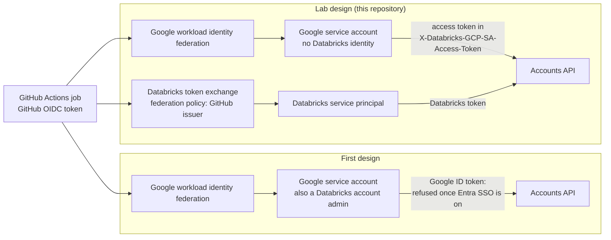

# The use case: Entra ID for people, a keyless GitHub Actions identity outside Entra

**Written 2026-11-13, after the lab. Test status: [USE_CASE_RESULTS.md](USE_CASE_RESULTS.md).** This is the scenario behind the [test requirements](DATABRICKS_SSO_TEST_REQUIREMENTS.md). It covers what the organization wants, the pipeline it first designed, and why that design breaks. It then shows how the lab's design answers it, and how this exact combination was tested (§6; results in [USE_CASE_RESULTS.md](USE_CASE_RESULTS.md)). Facts (F) and hypotheses (H) are from the [requirements](DATABRICKS_SSO_TEST_REQUIREMENTS.md), findings (R) from [E1](deliverables/E1_RESULTS.md), and AIM facts (A) from the [AIM assessment](AIM_ENTRA_ASSESSMENT.md). Identifiers are placeholders.

## 1. Starting point

- The organization already runs a Databricks account on another cloud, with Microsoft Entra ID for single sign-on. It is now building a separate Databricks account on Google Cloud.
- Entra ID is its primary identity provider. It chose Entra so that it doesn't have to manage people as Google identities.
- People are added to the Databricks account by hand today. The goal is automatic identity management (AIM), with workspace access driven by Entra groups.
- The workspaces use classic compute, a customer-managed VPC, and Private Service Connect for private access. Whether to use one workspace project or two is still open.
- CI is GitHub Actions running Terraform, with no keys.

## 2. The pipeline as first designed

The first design follows the Platform Deployment Kit's GCP template (F9):

1. A GitHub Actions job exchanges its GitHub OIDC token through Google workload identity federation.
2. It impersonates a Google service account that holds the [workspace creation permissions](https://docs.databricks.com/gcp/en/admin/workspace/create-workspace) on the workspace project.
3. The same service account is added to the Databricks account as account admin.
4. The Databricks provider signs in as that service account, with a Google ID token:

   ```hcl
   provider "databricks" {
     alias                  = "accounts"
     host                   = "https://accounts.gcp.databricks.com"
     google_service_account = var.google_service_account_email
     account_id             = var.databricks_account_id
   }
   ```

5. Terraform creates the network configuration, the endpoint registrations and the workspace through the Accounts API.

So one Google identity is both the pipeline's GCP identity and its Databricks identity, and it lives outside Entra.



## 3. What the organization needs

| # | Need |
|---|---|
| N1 | People sign in to the account and the workspaces through Entra SSO, as they do on the other cloud |
| N2 | People and groups come from Entra, and workspace access follows Entra groups (AIM is the goal) |
| N3 | The pipeline's identity stays out of Entra: in the first discussion the team said it didn't want the pipeline's identity in its directory. A later question asked about the opposite, an Entra identity provisioned by AIM; the [AIM assessment](AIM_ENTRA_ASSESSMENT.md) covers it |
| N4 | GitHub Actions creates and changes workspaces with Terraform, with no console step |
| N5 | No keys or stored secrets |
| N6 | Classic compute behind Private Service Connect |
| N7 | A user and group sync that lasts. The roadmap for SCIM-based provisioning on accounts that use Entra ID or Okta; how it applies to GCP accounts is to be confirmed with Databricks (requirements §7) |

## 4. Why the first design breaks, and the choice it seems to force

- Own-IdP SSO turns off Google ID token authentication for the whole account (F2). No exception exists for a single identity, so step 4 stops working for the service account as soon as Entra SSO goes on. Prior evidence: `401` on every account call after SSO was turned on (H1).
- AIM with Entra requires Entra SSO configured on the same tenant (A2; [Migrate to AIM](https://docs.databricks.com/gcp/en/admin/users-groups/automatic-identity-management/migrate-to-aim)). For accounts without SSO, or with a different tenant, the page says to contact the Databricks account team.

With the first design, the organization seems to face a binary choice:

| | Keep Google sign-in | Turn on Entra SSO |
|---|---|---|
| N1 Entra sign-in for people | No | Yes |
| N2 AIM with Entra groups | Not self-service (A2) | Yes |
| N4 The first design's Terraform | Works (H10, prior evidence) | Breaks (F2, H1) |
| N7 Sync after the SCIM retirement | Open | AIM |

## 5. How the lab's design removes the choice

The lab kept own-IdP SSO on and changed only the pipeline's Databricks identity (option A in the [AIM assessment](AIM_ENTRA_ASSESSMENT.md)):

- A Databricks service principal, created by [`bootstrap/`](../bootstrap/), trusts GitHub's OIDC token through a federation policy ([E3](deliverables/E3_IDENTITY.md)). It exists in the Databricks account and nowhere else, so it meets N3, and SSO doesn't apply to it.
- The Google service account stays, for GCP and for the `X-Databricks-GCP-SA-Access-Token` header. It needs no Databricks identity (H5).
- The objects that need the header go through the REST provider, and everything else through the Databricks provider ([E2](deliverables/E2_CAPABILITIES.md), [E4](deliverables/E4_RECOMMENDATION.md)).

| Need | Lab result | Status |
|---|---|---|
| N1 | On Entra SSO: people sign in through Entra over the front end (U4); the pipeline unaffected (U1a, U1, U2) | Proven |
| N2 | With AIM on: an Entra group assigned and entitled by Terraform gives its members, nested groups included, workspace access; others refused (U3, U4, R17, R18) | Proven |
| N3 | Databricks-native principal (E3), unaffected by Entra SSO and AIM (U1). An Entra principal synced by AIM also works, if wanted (U7, R16) | Proven |
| N4 | One-pass rebuild from empty state (E1) | Proven |
| N5 | Federation only (E3) | Proven |
| N6 | Back-end and front-end PSC ([PSC scenarios](PSC_SCENARIOS.md)) | Proven |
| N7 | Outside the lab's scope | Open |

## 6. What to build and test for this use case

Before these tests, the organization's target hadn't been tested as a whole: **Entra SSO and AIM on the same account, with the lab's pipeline unchanged.** The tests ran on 2026-11-13 and 14; the results are in [USE_CASE_RESULTS.md](USE_CASE_RESULTS.md).

**Prerequisites**
- A Databricks on GCP account on Enterprise (AIM isn't available on Standard, A1; PSC needs Enterprise), with Entra SSO and Entra AIM on. **Decided 2026-11-13: the existing shared account,** switched from its previous identity provider to Entra for the test and back afterwards; a dedicated account isn't practical, since GCP allows one Databricks account per billing account. The switch changes sign-in for every workspace on the account for the window. Have two account admins, and keep one session open while SSO changes (F12). Details: [USE_CASE_TEST_PLAN.md](USE_CASE_TEST_PLAN.md).
- An Entra test tenant with:
  - the SSO app;
  - the AIM app registration and permissions the [AIM setup page](https://docs.databricks.com/gcp/en/admin/users-groups/automatic-identity-management/ms-entra-id) asks for;
  - two test users;
  - a test group containing one of the users;
  - a nested group inside that group.
- This repository, built by [REPRODUCE.md](REPRODUCE.md).

| # | Test | Expected | What it shows |
|---|---|---|---|
| U1 | Turn on AIM. Run `auth-check` unchanged | The native principal's token exchange still works | Expected, not documented: AIM leaves alone the principals it didn't sync. N3 |
| U2 | One-pass build ([REPRODUCE.md](REPRODUCE.md) §3) on that account | Same as in E1 | N4 with Entra SSO and AIM on |
| U3 | Add the test group to the account from Entra, in the account console. In the `databricks/` stack, look it up and assign it to the workspace with `databricks_mws_permission_assignment` | Lookup and assignment work for the directly added group. The nested group can't be read through the API or Terraform | N2. The [AIM page](https://docs.databricks.com/gcp/en/admin/users-groups/automatic-identity-management) says workspace assignment of synced groups is a separate step. It also says nested groups that aren't directly provisioned "can't be retrieved or managed through the Databricks APIs or Terraform" |
| U4 | A group member signs in through Entra from inside the network, the way `psc-refusal` does. Then the non-member signs in | The member is created just-in-time and reaches the workspace through the group. The non-member gets no workspace access | N1 and N2 |
| U5 | Disable a test user in Entra. Run `auth-check` | The user can't sign in, and the pipeline is unaffected | N3: the pipeline doesn't depend on Entra |
| U6 | Optional: create a workspace in the console with matching and non-matching Google accounts (H9) | As in H9 | A fallback if the REST provider isn't accepted |

U1, U3 and U5 are account-level and cost nothing. U2 and U4 cost what the lab did (see the README, "Cost while built"). Record each step the way the [test plan](TEST_PLAN.md) §6 does, with placeholders.

## 7. What the result answers

- **If U1 to U4 pass:** the organization can turn on Entra SSO and AIM for people. It can also keep a keyless Terraform pipeline whose Databricks identity stays out of Entra. This is the lab's design ([E4](deliverables/E4_RECOMMENDATION.md)) on an Entra account.
- **If U1 or U2 fails:** options B and C in the [AIM assessment](AIM_ENTRA_ASSESSMENT.md), an Entra principal synced by AIM, are the next path. In every case the Google token header stays.
- **Result (2026-11-14):** U1 to U5 passed ([USE_CASE_RESULTS.md](USE_CASE_RESULTS.md)), so the first case applies. Option C (U7) also works, at account level.
