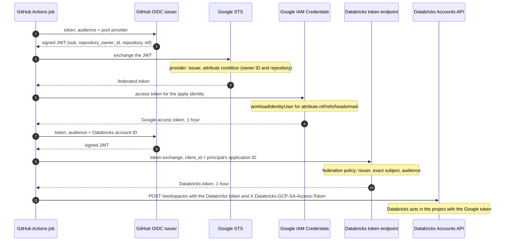

# E3. Identity design

**2026-11-13, after the end-to-end rebuild.** Every identity the pipeline and its operators use, what each trusts, what it holds, and why. No identity has a key or a stored secret: GitHub's OIDC token is exchanged for short-lived Google and Databricks credentials in each job.

## How a job authenticates

Steps 1–6 are `google-github-actions/auth`; steps 7–10 are what the Databricks provider does itself with `auth_type = "github-oidc"`. Workspace-level calls exchange the same kind of token at the workspace's own endpoint (`https://<workspace>/oidc/v1/token`). The trust in every note is created once by [`bootstrap/`](../../bootstrap/) (see [AUTH_BOOTSTRAP.md](../AUTH_BOOTSTRAP.md)); `auth-check` runs the chain and shows each hop's result without printing a credential.

## Pipeline identities

| Identity | Kind | Trusts (who can become it) | Holds | Why |
|---|---|---|---|---|
| **Apply identity** | Google service account in the CI project | Workload identity pool provider for `token.actions.githubusercontent.com`, condition on the repository's owner ID **and** repository name; `roles/iam.workloadIdentityUser` for `attribute.ref/refs/heads/main` only | Owner (or a narrower custom set) on the workspace project(s); the state bucket | Plans on `main` and applies them; the source of the `X-Databricks-GCP-SA-Access-Token` header. Needs no Databricks identity (H5) |
| **Plan identity** | Google service account | Same pool; `roles/iam.workloadIdentityUser` for `attribute.repository/<owner>/<repo>` (any ref) | Viewer, Security Reviewer; read on the state bucket | Read-only pull-request plans of the GCP stack, without a state lock. Anyone who can open a pull request can use it, so it must never hold a write permission. It can't initialize an empty state, so a new setup's first plan runs on `main` (R11) |
| **Databricks automation principal** | Databricks service principal, account admin | Service principal federation policy: issuer `https://token.actions.githubusercontent.com`, subject `repo:<owner>@<owner-id>/<repo>@<repo-id>:ref:refs/heads/main` (R1), audience the account ID | Account admin; workspace admin on the workspaces it manages | Account- and workspace-level Terraform. Main only: Databricks has no read-only account role a pull-request identity could hold, so Databricks plans run on `main` |

## Why these boundaries

- **Owner ID and repository name** in the Google pool's condition: a deleted account's name can be registered again; its numeric ID can't.
- **`main` only** for the identities that can write: a free private repository has no branch protection or environment reviewers, so the collaborator list is the real boundary. On a paid plan, bind the apply identity and the federation policy to a GitHub **environment** with required reviewers instead of the branch (Databricks recommends the Environment entity type).
- **The subject's immutable-ID form** (R1): `bootstrap/` builds it from the numeric IDs; otherwise copy it from a real token or a first run's `TOKEN_SUBJECT_INVALID` error.
- **Created by administrators, not the pipeline:** an identity can't be trusted to create itself. `bootstrap/` is Terraform with its own state in an administrators' bucket, applied locally with their sign-ins; its outputs are the repository variables.
- **Self-hosted runners** use the same identities: their jobs get GitHub OIDC tokens like hosted ones. Hardening option: require `assertion.runner_environment == "self-hosted"` in the pool condition for an identity used only by the workspace stack.

## Human identities

| Identity | Holds | Used for |
|---|---|---|
| Databricks account admins (at least two) | Account admin, signed in through the IdP | The principal and its federation policy; break-glass. With SSO on, a broken IdP locks out every admin (F12) |
| GCP administrators | Project creation, organization policy | Bootstrap; the domain restricted sharing prerequisite |
| Repository admins | GitHub repository | Merging, running the manual apply, registering runners |

## Databricks-owned identities (created by Databricks during provisioning)

| Identity | Granted | Where |
|---|---|---|
| Workspace service account (`db-<workspace-id>@prod-gcp-<region>…`) | Two project custom roles; a network custom role | Workspace project; the subnet |
| Regional metastore storage credential (`db-uc-credential-…@uc-<region>…`) | `storage.objectAdmin`, `storage.insightsCollectorService` | The workspace's default Unity Catalog bucket |

These are the grants a domain restricted sharing profile must admit (R3).
