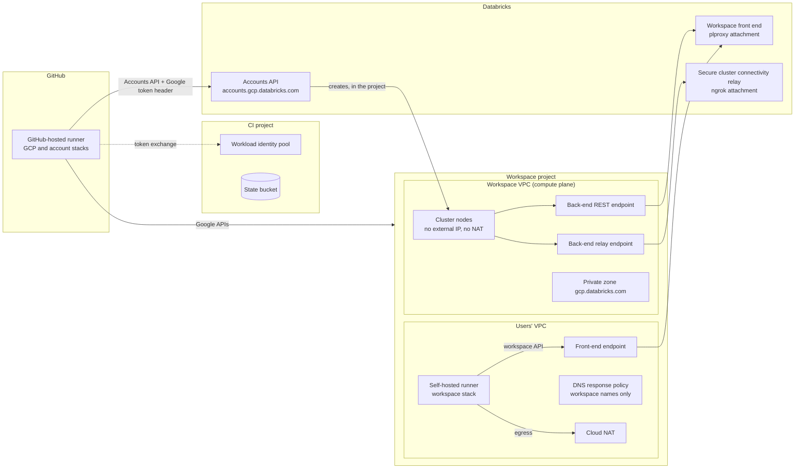

# E6. Configuration guide: Databricks on GCP from GitHub Actions with Terraform, own-IdP SSO (Entra ID and AIM), Private Service Connect

**2026-11-14, verified by an end-to-end rebuild and on Entra SSO with AIM.** End to end, in build order. The reference implementation (E5) is this repository; file names below refer to it. Placeholders: `<org-id>`, `<ci-project>`, `<ws-project>`, `<account-id>`, `<owner>`, `<owner-id>`, `<repo>`, `<repo-id>`, `<region>`.

## 0. Architecture

| Plane | Endpoint | Runs on | Auth |
|---|---|---|---|
| GCP infrastructure | Google APIs | GitHub-hosted runner | GitHub OIDC → Google workload identity federation → apply identity |
| Databricks account | `accounts.gcp.databricks.com` (public, also with PSC) | GitHub-hosted runner | GitHub OIDC → Databricks token exchange (automation principal), plus the apply identity's Google access token in `X-Databricks-GCP-SA-Access-Token` for workspaces, network configurations and endpoint registrations |
| Databricks workspace | `<workspace-id>.<n>.gcp.databricks.com`, private once public access is off | Self-hosted runner in the users' network | GitHub OIDC → token exchange at the workspace's own endpoint, through the front-end PSC endpoint |

Three Terraform stacks, each with its own state: GCP (repository root), Databricks account (`databricks/`), Databricks workspace (`workspace/`). A fourth root, `bootstrap/`, holds the pipeline's own authentication and is applied by administrators, not the pipeline.



## 1. Prerequisites set by administrators (once)

Items 1, 4 and 5 are one Terraform root, `bootstrap/`, applied locally by GCP and Databricks administrators with their own sign-ins; its outputs are the repository variables ([AUTH_BOOTSTRAP.md](../AUTH_BOOTSTRAP.md)). An identity can't be trusted to create itself, so the pipeline never applies it.


1. **CI project and workload identity pool** for GitHub ([Google: workload identity federation with deployment pipelines](https://cloud.google.com/iam/docs/workload-identity-federation-with-deployment-pipelines)):
   - Provider issuer `https://token.actions.githubusercontent.com`; attribute mapping for `sub`, `repository`, `repository_owner_id`, `ref`.
   - **Attribute condition on the owner's numeric ID and the repository name.** Without a condition, any GitHub repository can mint tokens against the pool.
   - Apply identity: `roles/iam.workloadIdentityUser` for `principalSet://…/attribute.ref/refs/heads/main`. Plan identity: for `principalSet://…/attribute.repository/<owner>/<repo>`, read-only roles only.
   - State bucket: versioned, uniform access, public access prevention.
2. **Workspace project(s)** with the APIs the stacks enable (Compute, DNS, IAP if used), and the apply identity's permissions there.
3. **Domain restricted sharing** (if the organization restricts `iam.allowedPolicyMemberDomains`): a project-level exception adding Databricks' Google customer ID, with `inherit_from_parent = true`, **narrowed** by an enforced custom constraint that admits only:
   - the workspace service accounts in `/roles/databricks.project.`, `/roles/databricks.resource.`, `/roles/databricks.network.` roles;
   - the regional metastore credential in `roles/storage.objectAdmin` and `roles/storage.insightsCollectorService`.

   Set by an Organization Policy Administrator; the Org Policy API refuses user credentials without a quota project. Check it by creating a workspace: provisioning fails partway with an org-policy message if a grant is missing (R2, R3).
4. **Databricks automation principal** ([Databricks: GitHub Actions federation](https://docs.databricks.com/gcp/en/dev-tools/auth/provider-github)): a service principal, account admin ([F6](https://docs.databricks.com/gcp/en/dev-tools/auth/oauth-m2m)), with a federation policy:
   - issuer `https://token.actions.githubusercontent.com`;
   - subject **`repo:<owner>@<owner-id>/<repo>@<repo-id>:ref:refs/heads/main`**: GitHub issues the immutable-ID form; copy it from a first run's `TOKEN_SUBJECT_INVALID` error rather than typing it (R1). In a public repository, or a private one on GitHub Enterprise, prefer an environment subject with required reviewers;
   - audience: the default, the account ID.
5. **Repository variables** (not secrets; nothing here is secret), from `bootstrap/`'s outputs: `GCP_WIF_PROVIDER`, `GCP_APPLY_SA`, `GCP_PLAN_SA`, `TF_STATE_BUCKET`, `DATABRICKS_ACCOUNT_ID`, `DATABRICKS_CLIENT_ID` (the principal's application ID). Then run `auth-check`, which shows each hop of the chain without printing a credential.
6. **Entra SSO and AIM** (when people come from Entra; [Databricks: automatic identity management](https://docs.databricks.com/gcp/en/admin/users-groups/automatic-identity-management)):
   - Entra SSO for the account, then AIM on the **same tenant** (AIM requires it); Premium or Enterprise tier; identity-federated workspaces (new workspaces with a Unity Catalog metastore are).
   - Add each Entra group that should reach a workspace to the account from Entra (account console). Until then Terraform can't see it (R17).
   - Tenant policies apply to Databricks sign-in: a policy requiring MFA registration stops new or test users at Entra until they register or are excluded.
   - The pipeline's principal is unaffected by both (U1); nothing in steps 1–5 changes.

## 2. Pipeline

`.github/workflows/terraform.yml`, `apply.yml`:

- **Validate** on every pull request and push: `fmt`, `validate` for each stack, Trivy.
- **Plan** on pull requests as the plan identity (GCP stack only, `-lock=false`, no saved plan). On `main` as the apply identity, for each stack, saving `plan.cache` and the lock file as an artifact.
- **Apply** by hand (`workflow_dispatch`) on `main`, given a plan run's ID: it checks that the run is a successful push to `main` whose commit main has moved past only with documentation, downloads that run's plan, and applies it. Apply the GCP stack before the Databricks one.
- **The first plan of a new setup runs on `main`.** With an empty state bucket, `init` writes each stack's empty state and lock, which the read-only plan identity can't (R11).
- Pin every action to a commit SHA; pin providers exactly where they're pre-1.0.

## 3. Account stack: the REST provider for header-requiring objects

`databricks/rest.tf`:

```hcl
variable "databricks_token" {
  type      = string
  sensitive = true
  ephemeral = true
}

variable "gcp_access_token" {
  type      = string
  sensitive = true
  ephemeral = true
}

provider "restful" {
  base_url = "https://accounts.gcp.databricks.com/api/2.0/accounts/${var.account_id}"
  security = { http = { token = { token = var.databricks_token } } }
  header   = { "X-Databricks-GCP-SA-Access-Token" = var.gcp_access_token }
}
```

The job mints both in the step that runs Terraform: the Databricks token by exchanging the job's GitHub OIDC token (audience the account ID) at `/oidc/accounts/<account-id>/v1/token`; the Google token from `google-github-actions/auth` with `token_format: access_token`. **A saved plan's apply must be given them again** (ephemeral values aren't in the plan).

Resources (`restful_resource`), each with `path`, `read_path = "<collection>/$(body.<id field>)"`, `create_method = "POST"`:

| Object | Collection | Notes |
|---|---|---|
| VPC endpoint registration | `/vpc-endpoints` | Body `vpc_endpoint_name`, `gcp_vpc_endpoint_info { project_id, psc_endpoint_name, endpoint_region }`. Registration accepts the endpoint |
| Network configuration | `/networks` | Body `gcp_network_info { network_project_id, vpc_id, subnet_id, subnet_region }`, and for back-end PSC `vpc_endpoints { rest_api = [...], dataplane_relay = [...] }`. One per workspace; a failed workspace keeps it (R5) |
| Workspace | `/workspaces` | `update_method = "PATCH"`, `update_query = { update_mask = ["<changed fields>"] }` (R4); `poll_create` and `poll_update` on `body.workspace_status` until `RUNNING`, pending `PROVISIONING` |

Everything else at account level uses the Databricks provider on `github-oidc` (`DATABRICKS_AUTH_TYPE=github-oidc`, `DATABRICKS_CLIENT_ID`): private access settings, workspace permission assignments.

**Ordering rule (R6):** never remove an object and a workspace's reference to it in the same apply; detach first.

## 4. Private Service Connect

See [`../PSC_SCENARIOS.md`](../PSC_SCENARIOS.md). For back-end PSC from creation:

1. **GCP stack:** workspace VPC with a compute subnet and an endpoint subnet; two consumer endpoints (forwarding rules, `load_balancing_scheme = ""`, `no_automate_dns_zone = true`) on Databricks' regional service attachments for the workspace (REST, `plproxy-psc-endpoint-all-ports`) and the relay (`ngrok-psc-endpoint`); a private `gcp.databricks.com` zone on that VPC with `<region>.psc` and the workspace URL and `dp-` name to the REST endpoint, and `tunnel.<region>` to the relay. ([Databricks: Private Service Connect on GCP](https://docs.databricks.com/gcp/en/security/network/classic/private-service-connect))
2. **Account stack:** register both endpoints; network configuration listing them; private access settings; the workspace.
3. **Front end:** an endpoint on the workspace attachment in the users' network, registered the same way; **DNS for users by response policy (or conditional forwarding), not a whole-domain zone** (R7): the workspace URL, `dp-` name and `<region>.psc-auth` to the front-end endpoint. Then private access settings with public access off.

## 5. Workspace stack on a self-hosted runner

Once public access is off, workspace-level Terraform runs inside the users' network:

- **Runner:** a VM with no external IP, Cloud NAT for egress (GitHub, HashiCorp, Google's STS, the account API), the users' DNS. Run it as a dedicated user without sudo, with a label only the workspace workflow uses; prefer ephemeral runners (one job each) registered just in time by a GitHub App. `scripts/register-runner.sh` registers a long-lived one by hand for a lab.
- **Principal:** workspace admin through a `databricks_mws_permission_assignment` in the account stack.
- **Provider:** `host` the workspace URL, `github-oidc`. Token exchange and API calls go through the front-end endpoint.
- **Clusters:** set an access mode (dedicated or standard), or a Unity Catalog workspace refuses them (R9).
- **Workspace URL** from the account stack's state (`terraform_remote_state`), not copied. A script that needs it before the stack's first apply reads it with `terraform console -plan` (R13).

## 6. People and groups from Entra (AIM)

With Entra SSO and AIM, workspace access follows Entra groups. Two Terraform objects per group, in two stacks, both needed (R18):

```hcl
# databricks/ (account stack): assign the group to the workspace
data "databricks_group" "workspace" {
  for_each     = var.workspace_groups             # { "<entra-group>" = ["USER"] }
  display_name = each.key
}

resource "databricks_mws_permission_assignment" "group" {
  for_each     = var.workspace_groups
  workspace_id = <workspace id>
  principal_id = tonumber(data.databricks_group.workspace[each.key].id)
  permissions  = each.value
}

# workspace/ (workspace stack, on the self-hosted runner): give it an entitlement
data "databricks_group" "entitled" {
  for_each     = var.group_entitlements           # { "<entra-group>" = { workspace_access = true } }
  display_name = each.key
}

resource "databricks_entitlements" "group" {
  for_each              = var.group_entitlements
  group_id              = data.databricks_group.entitled[each.key].id
  workspace_access      = each.value.workspace_access ? true : null
  databricks_sql_access = each.value.databricks_sql_access ? true : null
  workspace_consume     = each.value.workspace_consume ? true : null
}
```

- **Order:** add the group from Entra; apply the account stack (assignment); apply the workspace stack (entitlement). An assignment alone lets members reach the workspace and then refuses them: "not assigned or no Workspace access entitlement" (R18). In a new workspace the built-in `users` group carries no entitlement to fall back on.
- **Entitlements unset unless true:** the provider refuses `workspace_consume` next to `workspace_access` or `databricks_sql_access`, even when one of them is `false`.
- **Nested groups:** members of a group nested inside an assigned group get access, but the nested group itself isn't visible to the API or Terraform unless it is added to the account from Entra too (R17). Assign the parent.
- **Users** are created at first sign-in and linked to Entra a few minutes later; nothing to manage in Terraform.
- **Private sign-in:** with public access off, people reach the workspace only through the front-end endpoint (their network's DNS to it); from the internet they are refused after signing in: the pipeline's identity got `403` "Unauthorized network access" (R12), and a member's sign-in from the internet was refused too, though before their group had its entitlement (U4). To test it from outside the network, a browser on an SSH SOCKS proxy through a VM in the users' network, with DNS resolved on the VM's side, shows the private path.
- **Leavers:** disable in Entra (new sign-ins through Entra stop) and revoke their personal access tokens in Databricks, as the AIM page recommends for deactivated users: the Databricks user still read `active` minutes later (R19).
- **The Entra groups themselves** (and nesting) as Terraform: [`examples/entra/`](../../examples/entra/) (`groups.tf`).

## 7. Optional: the pipeline's identity from Entra (option C)

If the pipeline's Databricks identity must be owned in Entra ([AIM assessment](../AIM_ENTRA_ASSESSMENT.md)); proven at account level (R16), not yet through a full build:

1. An Entra app registration with no secret and no API permissions, and its service principal.
2. Add it to the account from Entra (account console). Its Databricks application ID is the Entra client ID.
3. Give it account admin, and a service principal federation policy with the same issuer and immutable-ID subject as step 1.4. With the Databricks CLI on Windows PowerShell 5.1, pass JSON bodies as `--json @file`: inline JSON is mangled.
4. Set `DATABRICKS_CLIENT_ID` to its application ID; `auth-check` (with `client_id`) shows it signing in.

Terraform can't create this principal in Databricks; it can manage it by application ID once provisioned. [`examples/entra/`](../../examples/entra/) (`pipeline_principal.tf`) does steps 1 and 3 as Terraform, with the provisioning step between two applies; it also holds an untested option B. The Google side (the apply identity and the header) is unchanged.

## 8. Verification

| Check | Expect | In the lab's rebuild |
|---|---|---|
| Authentication | `auth-check`: GitHub claims, the apply identity's Google token, the principal reading its own record | Passed |
| Endpoints | All `ACCEPTED` | All three |
| Workspace | `RUNNING`; a cluster starts in the back-end PSC VPC with no external IP and no NAT | Both workspaces; the cluster in 4m 51s |
| From the users' network | The workspace URL resolves to the front-end endpoint; `accounts.gcp.databricks.com` resolves publicly; the workspace answers | As expected; `GET /` 303 |
| From the internet, as a workspace member (`psc-refusal`) | Refused at the API; the same identity through the front end succeeds (an unauthenticated request can't show this, R8) | `403` "Unauthorized network access to workspace" from the internet, `200` through the front end (R12) |
| Every stack | The next plan shows no changes | GCP and account: no changes; workspace: no resource changes |
| With Entra SSO and AIM: the pipeline | `auth-check` passes after each change | Passed (U1) |
| With Entra SSO and AIM: groups | `aim-check`: the group found, the workspace assignment listed; `workspace-identity-check`: the group on a member's workspace record, with its entitlement | As expected (U3, U4) |
| With Entra SSO and AIM: people, through the front end | A direct member and a nested member reach the workspace; someone in neither group is refused | As expected (U4) |
| With Entra SSO and AIM: people, from the internet | Refused after signing in | As expected (U4), though that sign-in came before the group's entitlement; the network refusal itself is R12 |
| A person disabled in Entra | Refused at Entra's sign-in; `auth-check` passes | As expected; the Databricks user still `active` minutes later (U5, R19) |

## 9. Teardown

Mind the account's daily workspace creation limit (R15) before tearing down and rebuilding on the same day. Workspace stack, then account stack, then GCP stack, each a reviewed `plan -destroy` applied by hand; apply only the newest destroy run (another apply in between makes it stale). In the account stack, workspaces go first (polled until 404), then their network configurations and registrations. **Between the account and GCP stacks, delete what Databricks left in the project** (R10): the `db-<vpc>-<region>-ingress` firewall rule on each workspace VPC, which blocks deleting the VPC, and by decision the workspace buckets. The organization's DRS exception and the principal are removed by their owners afterwards. With AIM, also remove the groups and principals added from Entra (and any users it created) from the account; they stay after a workspace is deleted. See [E7](E7_TEARDOWN.md).
